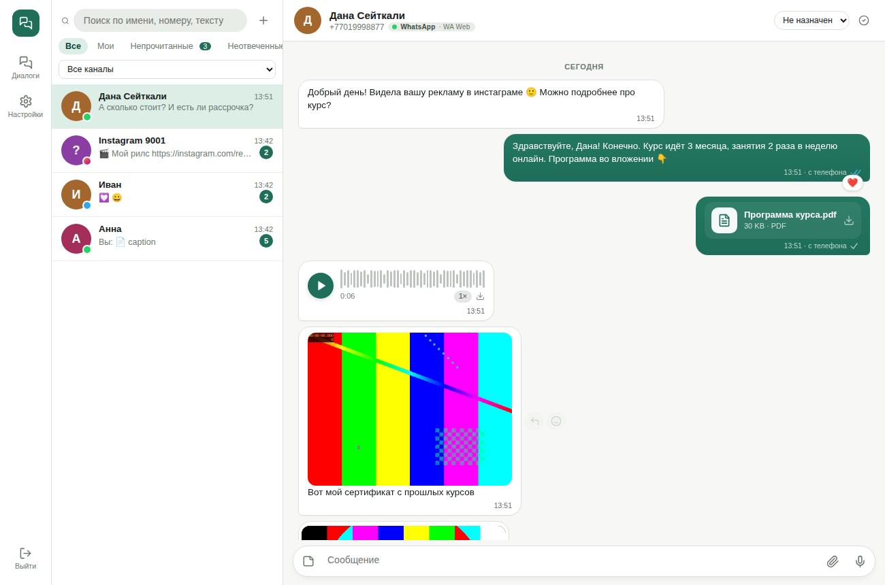

# Omnichat

Self-hosted omnichannel inbox for your team and your product: **WhatsApp Cloud API**, **WhatsApp Web (Baileys)**, **Instagram Direct** and **Telegram** in one chat UI — plus a REST API, outgoing webhooks and an embeddable chat widget so you can plug it into any CRM or back office.

Extracted from the chat of a production sales CRM and made generic. 🇷🇺 [Документация на русском](README.ru.md)



## Features

- **One inbox, four channels.** Conversations from every channel in one list; if a person writes from several channels (WhatsApp + Telegram…) their messages are merged into one feed with a channel switch in the composer.
- **Every message type**, both directions: text, photos, videos, round videos, GIFs, voice notes (waveform player), audio, documents of any type, stickers, locations, contact cards, polls, story replies/mentions, forwarded, edited and deleted messages, template messages.
- **Messenger behaviour:** delivery ticks (sent / delivered / read / played), reactions (incoming and outgoing), quoted replies, read receipts, 24-hour window indicator, retries for failed sends, optimistic upload with progress bar, drag & drop and paste from clipboard, voice recording in the browser.
- **Automatic media conversion** (ffmpeg) to what each messenger accepts: voice → OGG/Opus (WhatsApp, Telegram) or M4A (Instagram), any video → MP4 under the size limit, HEIC/WebP → JPEG, GIF → looping video, unsupported → sent as a file.
- **WhatsApp templates:** sync, create & submit for review, send with variables (header, body, URL buttons) and a live preview.
- **Team:** agents and admins, assignment, open/closed, filters (mine, unread, awaiting reply), search across names, phones and message text, internal notes.
- **Live:** Server-Sent Events, no polling. Russian and English UI, light/dark theme, mobile layout.
- **Integration:** REST API with API keys, signed outgoing webhooks, iframe embed scoped to one contact, `external_ref` to link contacts to your own records.

| Channel | How it connects | 24h window | Templates | Reactions | Receipts |
|---|---|---|---|---|---|
| WhatsApp Cloud API | Official Meta API, webhook | yes | yes | any emoji | sent / delivered / read |
| WhatsApp Web (Baileys) | Linked device via QR or pairing code | no | — | any emoji | sent / delivered / read / played |
| Instagram Direct | Instagram Messaging API, webhook | yes (7 days with HUMAN_AGENT tag) | — | ❤️ | seen |
| Telegram Bot | Bot API, webhook or long polling | no | — | Telegram's allowed set | sent |

> **WhatsApp Web (Baileys)** is an unofficial client of the WhatsApp Web protocol. It is great for normal conversations, but WhatsApp may ban numbers used for spam or bulk messaging. Use the Cloud API for anything high-volume.

## Quick start (Docker)

```bash
git clone <this repo> omnichat && cd omnichat
cp .env.example .env        # set PUBLIC_URL, JWT_SECRET, ENCRYPTION_KEY, ADMIN_*
docker compose up -d --build
```

Open `http://localhost:3000`, sign in with `ADMIN_EMAIL` / `ADMIN_PASSWORD` and connect channels in **Settings → Channels**.

For webhooks (WhatsApp Cloud, Instagram, Telegram webhook mode) the service must be reachable over **https** at `PUBLIC_URL` — put it behind nginx/Caddy/Traefik (see [Reverse proxy](#reverse-proxy)). Telegram and WhatsApp Web also work locally without a public URL (Telegram falls back to long polling).

### Without Docker

Requirements: Node.js ≥ 20, PostgreSQL ≥ 13, ffmpeg.

```bash
npm install
npm run build           # builds the web UI into web/dist
cp .env.example .env    # set DATABASE_URL and the rest
npm start               # runs migrations, creates the admin, starts on PORT
```

Development: `npm run dev` (API on :3000 with auto-reload, Vite on :5173 with proxy).

## Connecting channels

### WhatsApp Cloud API
1. In [Meta for Developers](https://developers.facebook.com/) create an app (type *Business*) and add the **WhatsApp** product.
2. In Business Settings create a **System User**, give it the app and the WhatsApp account, and generate a permanent token with `whatsapp_business_messaging` and `whatsapp_business_management`.
3. In Omnichat add a *WhatsApp Cloud API* channel: token, **Phone number ID**, **WhatsApp Business Account ID**, and (recommended) **App ID** + **App secret**.
4. Press **Subscribe webhooks** — Omnichat registers `PUBLIC_URL/webhooks/whatsapp` with the verify token shown on the card and links your WABA. (Or paste the URL and verify token manually in the App Dashboard → WhatsApp → Configuration, fields `messages`.)
5. Press **Sync templates**. Several numbers can share one app — add one channel per number.

### WhatsApp Web (Baileys)
Add a *WhatsApp Web* channel → a QR code appears on the card → on the phone open **WhatsApp → Linked devices → Link a device** and scan it. Alternatively set *Phone for pairing code* and enter the 8-character code on the phone. The session is stored in `DATA_DIR/baileys/<id>` and survives restarts; **Unlink device** logs it out. Messages you type on the phone also appear in the inbox (marked "from phone").

### Instagram Direct
1. Instagram professional account + a Meta app with the **Instagram** product ("Instagram API with Instagram Login").
2. Generate an access token for the account (starts with `IGAA…`; page tokens `EAA…` from Facebook Login also work — then fill *Instagram account ID*). Long-lived Instagram tokens are refreshed automatically every day.
3. Add an *Instagram Direct* channel, then in the app's **Webhooks** settings set the callback to `PUBLIC_URL/webhooks/instagram` with the verify token from the card and subscribe to `messages`, `messaging_postbacks`, `messaging_seen`, `message_reactions`.
4. Set **App secret** so webhook signatures are verified.

Instagram downloads the media you send from Omnichat by URL, so `PUBLIC_URL` must be public https. Replies are possible within 24 h of the customer's last message (7 days with the *HUMAN_AGENT* tag, if your app has that permission).

### Telegram
Create a bot with [@BotFather](https://t.me/BotFather), add a *Telegram Bot* channel with its token. With an https `PUBLIC_URL` the webhook is set automatically, otherwise long polling is used. Private chats with the bot appear in the inbox. Bots can download files up to 20 MB and send up to 50 MB.

## Plugging it into your project

Everything the UI does is available over the REST API. Create a key in **Settings → API & webhooks** and pass it as `X-Api-Key: ock_…` (or `Authorization: Bearer ock_…`).

### Typical flow for a CRM

```bash
API=https://chat.example.com/api; KEY="X-Api-Key: ock_..."

# 1. Start (or find) a conversation and link it to your record
curl -X POST $API/conversations/start -H "$KEY" -H 'Content-Type: application/json' \
  -d '{"channel_id": 1, "phone": "+77001234567", "name": "Anna", "external_ref": "deal-42"}'

# 2. Send a template (WhatsApp Cloud, outside the 24h window) …
curl -X POST $API/conversations/15/messages -H "$KEY" -H 'Content-Type: application/json' \
  -d '{"template": {"name": "order_ready", "language": "en", "params": {"1": "Anna", "2": "1042"}}}'

# … or text / a file
curl -X POST $API/conversations/15/messages -H "$KEY" -H 'Content-Type: application/json' -d '{"text": "Hello!"}'
curl -X POST $API/conversations/15/messages -H "$KEY" -F file=@invoice.pdf -F text="Your invoice"
curl -X POST $API/conversations/15/messages -H "$KEY" -H 'Content-Type: application/json' \
  -d '{"media_url": "https://example.com/photo.jpg", "text": "caption"}'

# 3. Show the chat inside your CRM
curl -X POST $API/embed/token -H "$KEY" -H 'Content-Type: application/json' \
  -d '{"external_ref": "deal-42", "user_email": "agent@example.com", "ttl": "12h"}'
# -> {"url": "https://chat.example.com/embed/7?token=...", ...}
```

```html
<iframe src="https://chat.example.com/embed/7?token=..." style="width:100%;height:700px;border:0" allow="microphone; clipboard-write"></iframe>
```

The embed shows only that contact's conversations (all channels merged) with the full composer. Its token cannot reach any other contact or admin endpoint. Restrict who may frame it with `EMBED_ORIGINS`.

### Outgoing webhooks

Add a URL in **Settings → API & webhooks**. Omnichat POSTs JSON `{event, data, at}` for `message.created`, `message.updated` (status, reaction, media downloaded, edit/delete), `conversation.updated`, `channel.updated` — with `X-Omnichat-Signature: sha256=<HMAC-SHA256(secret, raw body)>`, retried up to 3 times.

```js
// Node.js verification
const sig = 'sha256=' + crypto.createHmac('sha256', SECRET).update(rawBody).digest('hex');
if (!crypto.timingSafeEqual(Buffer.from(sig), Buffer.from(req.headers['x-omnichat-signature']))) return res.sendStatus(401);
```

### API reference

| Method | Path | |
|---|---|---|
| POST | `/api/auth/login` | `{email, password}` → `{token, user}` (JWT for agents) |
| GET | `/api/conversations` | `?q, filter=mine\|unassigned\|unread\|awaiting, channel_id, status, contact_id, external_ref, limit, before` |
| POST | `/api/conversations/start` | `{channel_id, phone \| chat_id, name, external_ref}` |
| GET / PATCH | `/api/conversations/:id` | PATCH `{assigned_user_id, status: open\|closed}` |
| POST | `/api/conversations/:id/read` | mark read (sends read receipts where supported) |
| GET | `/api/conversations/:id/messages` | `?before=<id>&after=<id>&limit=` |
| POST | `/api/conversations/:id/messages` | JSON `{text, reply_to_id, template, media_url, client_ref}` or multipart `file` (+`text`, `voice=1`) |
| POST | `/api/conversations/:id/notes` | `{text}` internal note |
| POST | `/api/messages/:id/react` | `{emoji}` (`""` removes) |
| POST | `/api/messages/:id/retry` | resend a failed message |
| GET / PATCH | `/api/contacts`, `/api/contacts/:id` | `?q, phone, external_ref`; PATCH `{name, phone, external_ref, custom}` |
| GET / POST / DELETE | `/api/templates` | list `?channel_id&approved=1`; create `{channel_id, name, language, category, header_text, body_text, footer_text, buttons}` |
| GET / POST / PATCH / DELETE | `/api/channels` | plus `/:id/test`, `/:id/restart`, `/:id/qr`, `/:id/actions/<subscribe_webhooks\|sync_templates\|logout\|reconnect\|refresh_token>` |
| POST | `/api/embed/token` | `{contact_id \| external_ref \| phone, user_id \| user_email, ttl}` |
| GET | `/api/events` | Server-Sent Events stream (`?token=`) |
| * | `/api/users`, `/api/admin/api-keys`, `/api/admin/webhooks` | team, keys, webhooks |

Messages carry `direction` (`in`/`out`/`note`), `status` (`pending`, `sent`, `delivered`, `read`, `played`, `failed`, `received`), `type` (`text`, `image`, `video`, `audio`, `voice`, `document`, `sticker`, `location`, `contact`, `template`, `unsupported`, `system`, `note`), `media_url` (signed, expiring link), `reply_to`, `reaction_in` / `reaction_out`, `payload` (location, contacts, template params, story, poll…).

## Reverse proxy

```nginx
server {
  server_name chat.example.com;
  client_max_body_size 110m;              # >= MAX_UPLOAD_MB
  location / {
    proxy_pass http://127.0.0.1:3000;
    proxy_set_header Host $host;
    proxy_set_header X-Forwarded-For $proxy_add_x_forwarded_for;
    proxy_set_header X-Forwarded-Proto $scheme;
    proxy_buffering off;                   # Server-Sent Events
    proxy_read_timeout 1h;
  }
}
```

Serving under a sub-path (`https://crm.example.com/chat`): set `BASE_PATH=/chat` and proxy `/chat/` to the service.

## Data

- PostgreSQL: users, channels (secrets encrypted with `ENCRYPTION_KEY`), contacts, conversations, messages, templates.
- `DATA_DIR/media`: every file sent or received (inbound media is downloaded immediately — messenger links expire). `DATA_DIR/baileys`: WhatsApp Web sessions. Back up both the database and `DATA_DIR`.

## Adding a channel

A channel is one module in `server/src/channels/` exporting `{ type, title, capabilities, fields, start, stop, send, react, markRead, test, router, actions }`. Inbound events go to `core/inbox.js` (`ingestInbound`, `updateStatus`, `setReaction`, `applyEdit`, `markDeleted`); contacts, conversations, storage, queueing, live updates and webhooks are handled there for every channel. Register it in `channels/index.js` and in the `channels.type` check constraint.

## License

MIT
