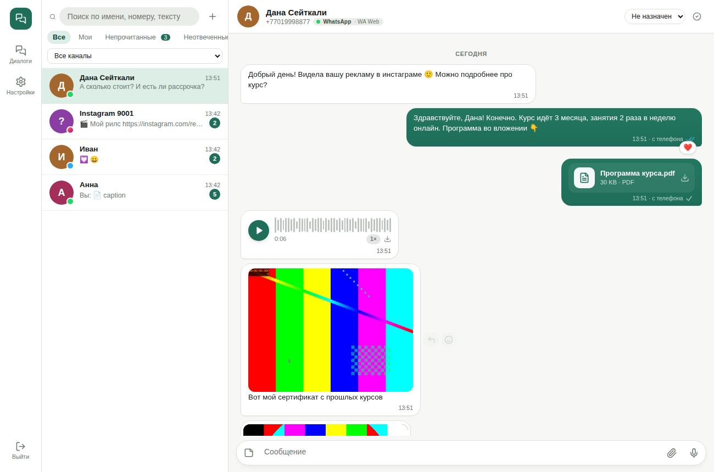

# Omnichat

Самостоятельно размещаемый омниканальный чат для команды и для вашего продукта: **WhatsApp Cloud API**, **WhatsApp Web (Baileys)**, **Instagram Direct** и **Telegram** в одном интерфейсе — плюс REST API, исходящие вебхуки и встраиваемый виджет чата, чтобы подключить его к любой CRM или админке.

Вынесен из чата рабочей CRM отдела продаж и сделан универсальным. 🇬🇧 [English](README.md)



## Возможности

- **Один инбокс — четыре канала.** Диалоги из всех каналов в одном списке; если человек пишет из нескольких каналов (WhatsApp + Telegram…), его сообщения сливаются в одну ленту, а в поле ввода есть переключатель канала.
- **Любые типы сообщений** в обе стороны: текст, фото, видео, кружки, GIF, голосовые (плеер с волной), аудио, документы любых форматов, стикеры, геолокация, контакты, опросы, ответы и упоминания в историях, пересланные, изменённые и удалённые сообщения, шаблоны.
- **Поведение мессенджера:** галочки (отправлено / доставлено / прочитано / прослушано), реакции (входящие и свои), ответы с цитатой, отметки о прочтении, индикатор 24-часового окна, повтор неотправленных, отправка файлов с прогрессом, drag & drop и вставка из буфера, запись голосовых в браузере.
- **Автоконвертация медиа** (ffmpeg) под требования каждого мессенджера: голос → OGG/Opus (WhatsApp, Telegram) или M4A (Instagram), любое видео → MP4 в пределах лимита, HEIC/WebP → JPEG, GIF → зацикленное видео, неподдерживаемое → отправляется файлом.
- **Шаблоны WhatsApp:** синхронизация, создание и отправка на проверку, отправка с переменными (заголовок, текст, кнопки-ссылки) и живым предпросмотром.
- **Команда:** операторы и администраторы, ответственный, открыт/закрыт, фильтры (мои, непрочитанные, неотвеченные), поиск по именам, телефонам и тексту, внутренние заметки.
- **Реальное время** через Server-Sent Events, без опросов. Интерфейс на русском и английском, светлая/тёмная тема, мобильная вёрстка.
- **Интеграция:** REST API с API-ключами, подписанные исходящие вебхуки, iframe-встраивание для одного контакта, `external_ref` для связи контактов с вашими записями (сделка, клиент).

| Канал | Подключение | Окно 24 ч | Шаблоны | Реакции | Статусы |
|---|---|---|---|---|---|
| WhatsApp Cloud API | Официальный API Meta, вебхук | да | да | любые эмодзи | отправлено / доставлено / прочитано |
| WhatsApp Web (Baileys) | Связанное устройство по QR или коду | нет | — | любые эмодзи | отправлено / доставлено / прочитано / прослушано |
| Instagram Direct | Instagram Messaging API, вебхук | да (7 дней с тегом HUMAN_AGENT) | — | ❤️ | просмотрено |
| Telegram-бот | Bot API, вебхук или long polling | нет | — | разрешённые Telegram | отправлено |

> **WhatsApp Web (Baileys)** — неофициальный клиент протокола WhatsApp Web. Для обычной переписки подходит отлично, но за спам и массовые рассылки WhatsApp может заблокировать номер. Для больших объёмов используйте Cloud API.

## Быстрый старт (Docker)

```bash
git clone <репозиторий> omnichat && cd omnichat
cp .env.example .env        # заполните PUBLIC_URL, JWT_SECRET, ENCRYPTION_KEY, ADMIN_*
docker compose up -d --build
```

Откройте `http://localhost:3000`, войдите с `ADMIN_EMAIL` / `ADMIN_PASSWORD` и подключите каналы в **Настройки → Каналы**.

Для вебхуков (WhatsApp Cloud, Instagram, Telegram в режиме вебхука) сервис должен быть доступен по **https** на `PUBLIC_URL` — поставьте перед ним nginx/Caddy/Traefik (см. [Reverse proxy](#reverse-proxy)). Telegram и WhatsApp Web работают и локально без публичного адреса (Telegram переходит на long polling).

### Без Docker

Нужны Node.js ≥ 20, PostgreSQL ≥ 13, ffmpeg.

```bash
npm install
npm run build           # собирает веб-интерфейс в web/dist
cp .env.example .env    # укажите DATABASE_URL и остальное
npm start               # миграции, создание админа, запуск на PORT
```

Разработка: `npm run dev` (API на :3000 с автоперезапуском, Vite на :5173 с прокси).

## Подключение каналов

### WhatsApp Cloud API
1. В [Meta for Developers](https://developers.facebook.com/) создайте приложение (тип *Business*) и добавьте продукт **WhatsApp**.
2. В настройках компании создайте **System User**, выдайте ему приложение и WhatsApp-аккаунт, сгенерируйте бессрочный токен с правами `whatsapp_business_messaging` и `whatsapp_business_management`.
3. В Omnichat добавьте канал *WhatsApp Cloud API*: токен, **Phone number ID**, **WhatsApp Business Account ID** и (желательно) **App ID** + **App secret**.
4. Нажмите **«Подписать вебхуки»** — Omnichat сам зарегистрирует `PUBLIC_URL/webhooks/whatsapp` с verify token из карточки и привяжет ваш WABA. (Или вставьте URL и verify token вручную: App Dashboard → WhatsApp → Configuration, поле `messages`.)
5. Нажмите **«Синхронизировать шаблоны»**. Несколько номеров могут работать через одно приложение — добавьте по каналу на каждый номер.

### WhatsApp Web (Baileys)
Добавьте канал *WhatsApp Web* → на карточке появится QR-код → на телефоне откройте **WhatsApp → Связанные устройства → Привязка устройства** и отсканируйте его. Либо укажите *телефон для кода* и введите 8-значный код на телефоне. Сессия хранится в `DATA_DIR/baileys/<id>` и переживает перезапуски; **«Отвязать устройство»** завершает её. Сообщения, написанные с самого телефона, тоже попадают в чат (с пометкой «с телефона»).

### Instagram Direct
1. Профессиональный аккаунт Instagram и приложение Meta с продуктом **Instagram** («Instagram API with Instagram Login»).
2. Сгенерируйте токен аккаунта (начинается с `IGAA…`; токены страниц `EAA…` через Facebook Login тоже подходят — тогда заполните *Instagram account ID*). Долгоживущий токен Instagram обновляется автоматически раз в сутки.
3. Добавьте канал *Instagram Direct*, затем в настройках **Webhooks** приложения укажите callback `PUBLIC_URL/webhooks/instagram` с verify token из карточки и подпишитесь на `messages`, `messaging_postbacks`, `messaging_seen`, `message_reactions`.
4. Укажите **App secret**, чтобы проверялись подписи вебхуков.

Instagram скачивает отправляемые вами файлы по ссылке, поэтому `PUBLIC_URL` должен быть публичным https. Ответить можно в течение 24 ч после последнего сообщения клиента (7 дней с тегом *HUMAN_AGENT*, если у приложения есть это разрешение).

### Telegram
Создайте бота через [@BotFather](https://t.me/BotFather) и добавьте канал *Telegram Bot* с его токеном. При https `PUBLIC_URL` вебхук ставится автоматически, иначе используется long polling. В чат попадают личные переписки с ботом. Боты скачивают файлы до 20 МБ и отправляют до 50 МБ.

## Подключение к вашему проекту

Всё, что делает интерфейс, доступно через REST API. Создайте ключ в **Настройки → API и вебхуки** и передавайте его как `X-Api-Key: ock_…` (или `Authorization: Bearer ock_…`).

### Типичная схема для CRM

```bash
API=https://chat.example.com/api; KEY="X-Api-Key: ock_..."

# 1. Начать (или найти) диалог и связать его с вашей записью
curl -X POST $API/conversations/start -H "$KEY" -H 'Content-Type: application/json' \
  -d '{"channel_id": 1, "phone": "+77001234567", "name": "Анна", "external_ref": "deal-42"}'

# 2. Отправить шаблон (WhatsApp Cloud, вне окна 24 ч) …
curl -X POST $API/conversations/15/messages -H "$KEY" -H 'Content-Type: application/json' \
  -d '{"template": {"name": "order_ready", "language": "ru", "params": {"1": "Анна", "2": "1042"}}}'

# … или текст / файл
curl -X POST $API/conversations/15/messages -H "$KEY" -H 'Content-Type: application/json' -d '{"text": "Здравствуйте!"}'
curl -X POST $API/conversations/15/messages -H "$KEY" -F file=@invoice.pdf -F text="Ваш счёт"
curl -X POST $API/conversations/15/messages -H "$KEY" -H 'Content-Type: application/json' \
  -d '{"media_url": "https://example.com/photo.jpg", "text": "подпись"}'

# 3. Показать чат внутри CRM (например, в карточке сделки)
curl -X POST $API/embed/token -H "$KEY" -H 'Content-Type: application/json' \
  -d '{"external_ref": "deal-42", "user_email": "manager@example.com", "ttl": "12h"}'
# -> {"url": "https://chat.example.com/embed/7?token=...", ...}
```

```html
<iframe src="https://chat.example.com/embed/7?token=..." style="width:100%;height:700px;border:0" allow="microphone; clipboard-write"></iframe>
```

Встроенный чат показывает только диалоги этого контакта (все каналы в одной ленте) с полноценным полем ввода. Его токен не даёт доступа ни к другим контактам, ни к админским функциям. Кто может встраивать — задаётся в `EMBED_ORIGINS`.

### Исходящие вебхуки

Добавьте URL в **Настройки → API и вебхуки**. Omnichat шлёт POST с JSON `{event, data, at}` на события `message.created`, `message.updated` (статус, реакция, медиа скачано, изменение/удаление), `conversation.updated`, `channel.updated` — с заголовком `X-Omnichat-Signature: sha256=<HMAC-SHA256(secret, тело)>`, до 3 попыток.

```js
// проверка подписи в Node.js
const sig = 'sha256=' + crypto.createHmac('sha256', SECRET).update(rawBody).digest('hex');
if (!crypto.timingSafeEqual(Buffer.from(sig), Buffer.from(req.headers['x-omnichat-signature']))) return res.sendStatus(401);
```

Полный список эндпоинтов — в [английском README](README.md#api-reference).

## Reverse proxy

```nginx
server {
  server_name chat.example.com;
  client_max_body_size 110m;              # не меньше MAX_UPLOAD_MB
  location / {
    proxy_pass http://127.0.0.1:3000;
    proxy_set_header Host $host;
    proxy_set_header X-Forwarded-For $proxy_add_x_forwarded_for;
    proxy_set_header X-Forwarded-Proto $scheme;
    proxy_buffering off;                   # Server-Sent Events
    proxy_read_timeout 1h;
  }
}
```

Под подпутём (`https://crm.example.com/chat`): `BASE_PATH=/chat` и проксируйте `/chat/` на сервис.

## Данные

- PostgreSQL: сотрудники, каналы (секреты зашифрованы `ENCRYPTION_KEY`), контакты, диалоги, сообщения, шаблоны.
- `DATA_DIR/media` — все отправленные и полученные файлы (входящие скачиваются сразу — ссылки мессенджеров истекают). `DATA_DIR/baileys` — сессии WhatsApp Web. Бэкапьте и базу, и `DATA_DIR`.

## Новый канал

Канал — это один модуль в `server/src/channels/`, экспортирующий `{ type, title, capabilities, fields, start, stop, send, react, markRead, test, router, actions }`. Входящие события передаются в `core/inbox.js` (`ingestInbound`, `updateStatus`, `setReaction`, `applyEdit`, `markDeleted`); контакты, диалоги, хранение файлов, очередь отправки, live-обновления и вебхуки там общие для всех каналов. Зарегистрируйте модуль в `channels/index.js` и в check-ограничении `channels.type`.

## Лицензия

MIT
